# Achmage Bases Look 1.4.0

Thumbnails, group colors and spreadsheet-style cell formatting for **core Obsidian Bases**: cards, kanban, table and list views.
No separate view or interface: your bases stay plain Bases, they just look and work better.

[한국어 설명은 아래에 있습니다.](#한국어) · [Changelog](CHANGELOG.md) · [Security](SECURITY.md) · [Contributing](CONTRIBUTING.md)


## New in 1.4.0: table formats in embedded bases

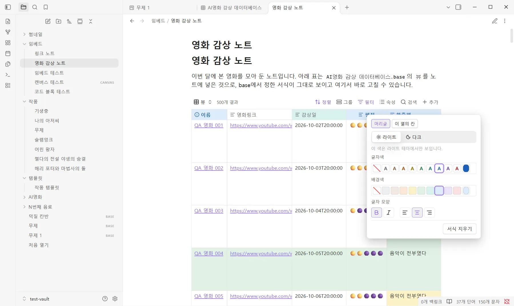

- **Formats show where a base is embedded.** A table view embedded in a note (`![[file.base#view]]`), written in a ```` ```base ```` code block, shown in a hover preview or on a canvas card shows the formats set in the base, in reading view and live preview, with each theme's own colors.
- **Change them right there.** Right-click a header, a cell or a dragged selection of an embedded table for **Format cells…**, fitting and clearing, as in a Bases tab. Double-clicking a column or row line, dragging the row line and the three table commands work too.
- **Saved by Obsidian, where it keeps the base.** A change made in an embedded `.base` file goes to that file, and an open Bases tab and the note follow each other. A change made in a code block goes to that code block, which Obsidian writes back in its own layout (as when you resize a column there).
- **Right-click the text of a cell.** The table menu now opens on the text of a cell too, not only on its empty part, and the right-click no longer starts editing the cell. A cell you are editing keeps its editing menu; links keep theirs.
- **Fitting measures text.** Fitting a column narrows a wide column as well as widening a narrow one.

| Header menu in an embedded table | |
|---|---|
| 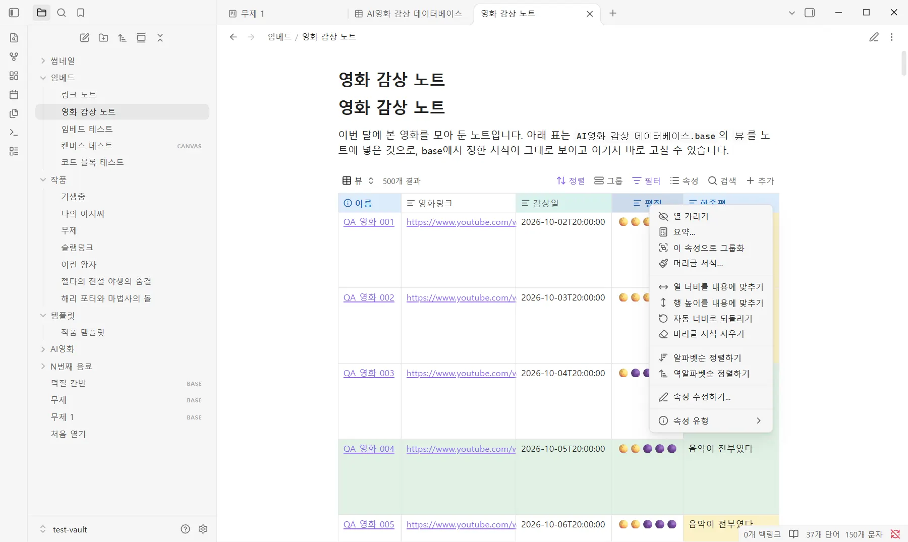 | Thumbnails, group colors and the look panel stay in Bases tabs; elsewhere an embedded base keeps Obsidian's own look. |

[1.4.0 release notes](release-notes/1.4.0.md)

## 1.3.0: format and fit tables like a spreadsheet

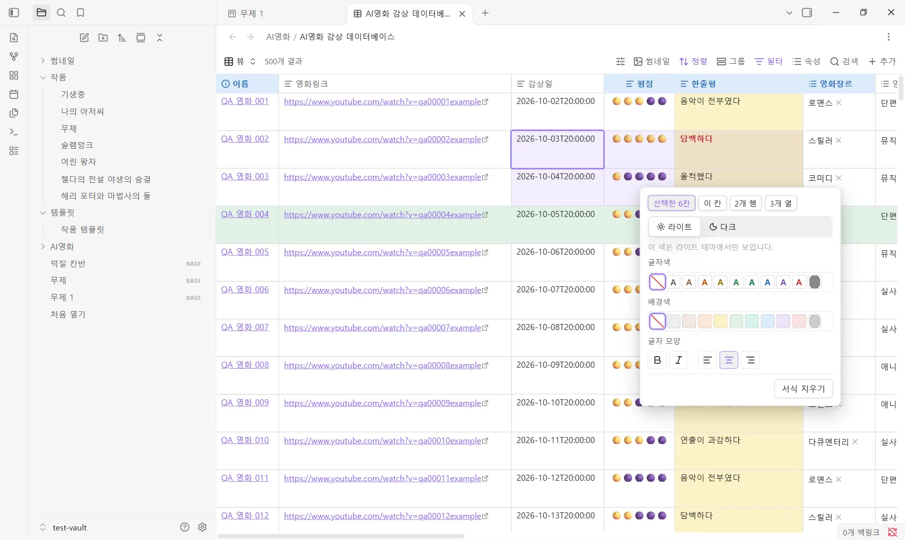

- **Right-click to format.** Right-click a header, a cell or cells you dragged over: **Format cells…** joins Obsidian's own menu. Set text color, fill (nine palette colors or any color), bold, italic and alignment for the header, the column, rows, one cell or the selected cells. A cell shows its column's format, then its row's, then its own.
- **Light and dark colors are kept apart.** Colors set in the light theme show in the light theme only, and dark ones in the dark theme only. The ☀/☾ tabs of the format window set the other theme's colors without switching. Bold, italic and alignment apply in both.
- **Double-click to fit.** Double-click the line between two column headers to fit the column to its content (long text wraps within the row height); double-click again for Obsidian's automatic width. Double-click the line under a row to fit the rows to the lowest of Obsidian's four row heights that shows everything, or drag it to step between them. Bases draws all rows of a view at one height, so rows are fitted per view.
- **Look panel and commands.** Table views get a **Table format** section (fit all columns, fit rows, clear all) and three commands.
- **Stored in the view, nothing else touched.** Formats live in that view's `achmageLook.format`; widths and heights are Obsidian's own `columnSize` and `rowHeight`, so they stay if you remove the plugin. Row and cell formats follow renamed and moved notes.

| Selection menu | Dark theme |
|---|---|
| 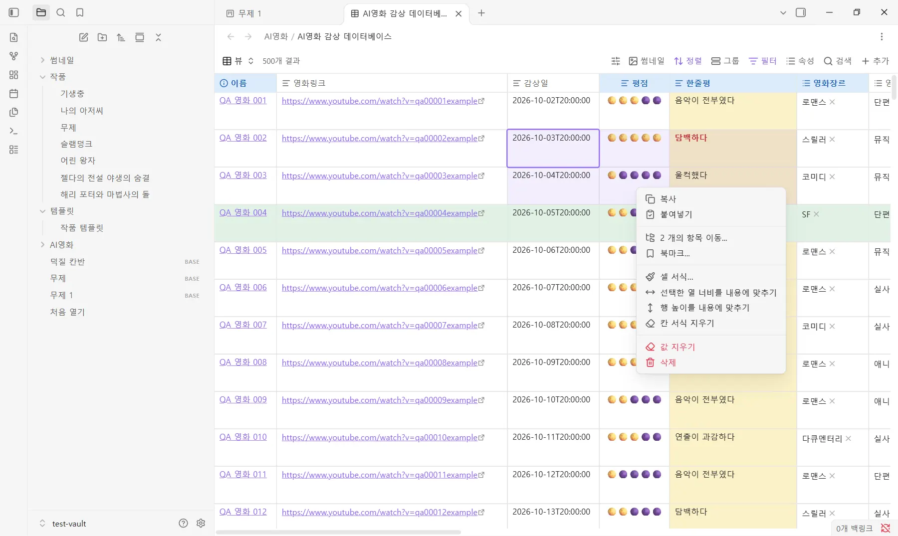 | 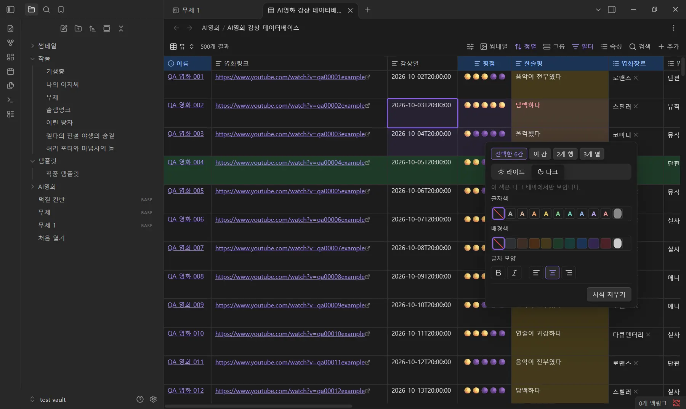 |

[1.3.0 release notes](release-notes/1.3.0.md)

## 1.2.0: each view its own look

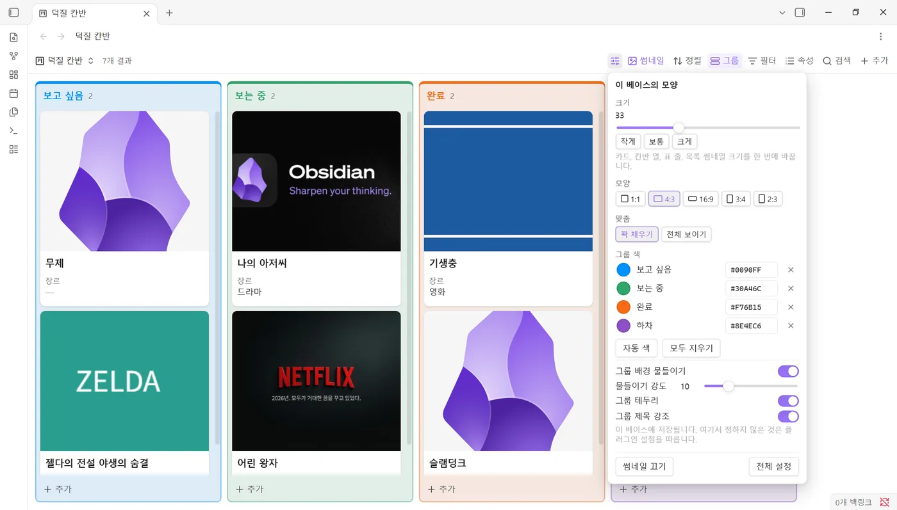

- **Every view keeps its own look.** Card size, column width, row height, list thumbnail size, thumbnail shape and fit, dashed frames, tidying, hover and group look are set per view. Changing the cards view never touches the kanban, list or table view of the same base.
- **The Thumbnails button works on the view on screen.** Turning thumbnails on or off in every view is a separate button under **This base**.
- **Everything is set in the base file.** The plugin settings only hold connections (Cloudflare R2, Eagle). Thumbnail property, image folder, saving and new-kanban settings are set per base; look settings per view.
- Nothing is rewritten on update: values set in earlier versions keep applying until you change them in a view.

[1.2.0 release notes](release-notes/1.2.0.md) · [1.1.0: each base keeps its own setup](release-notes/1.1.0.md)

<br clear="right">

## What it adds

- **Drop-in thumbnails.** Turn on thumbnails for a base with one click. Every card without an image shows a dashed frame: click it, or drop an image file or a web image on it.
- **One thumbnail window, four sources.** Drop or paste (Ctrl+V) an image, enter an image address, upload to **Cloudflare R2**, or pick from the **Eagle** app. The window says which property and folder the image goes to.
- **Paste anything as the address.** A web address on its own or inside a Markdown or HTML image, a wiki link or path to an image in the vault, an `obsidian://` link, a file path on your computer, or a `data:` image. Vault images are linked without a copy; addresses already on Cloudflare R2 are not uploaded again.
- **YouTube links.** A YouTube link becomes the video's preview image, and a ▶ button on the thumbnail opens the video. Other web addresses in the link property get a small open button.
- **New kanban views show their cards at once,** grouped by a status property (or the one from the settings) instead of stopping at “Choose a property”.
- **One look panel.** The sliders button next to “Thumbnails” holds **This view** (layout, size, shape, fit, frames, hover), **This base** (thumbnail property, link property, image folder, saving, new kanban, every view on/off) and **Groups** (colors shared by the base, look of this view). Sections fold, and the panel always fits in the window.
- **Group colors, rename and add groups.** Give each group its own color. The pencil next to a group renames it in every note of that group; **Add group** creates an empty group, such as a new kanban column.
- **Hover details.** Cards lift slightly under the mouse; table and list rows get a light highlight.
- **Table format.** Colors, bold, italic and alignment for headers, columns, rows and cells, per theme, from the right-click menu; double-click a border to fit a column or the rows. In Bases tabs and wherever the base is embedded.

| Group menu | Thumbnail window | Look panel |
|---|---|---|
| 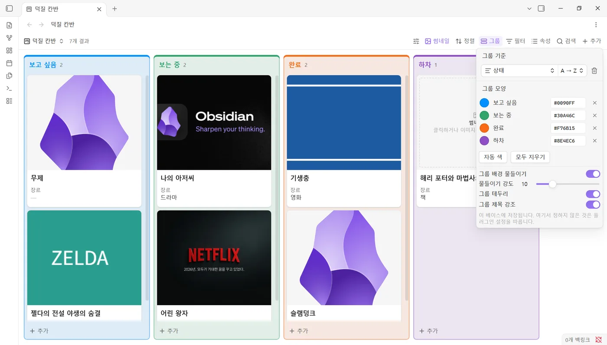 | 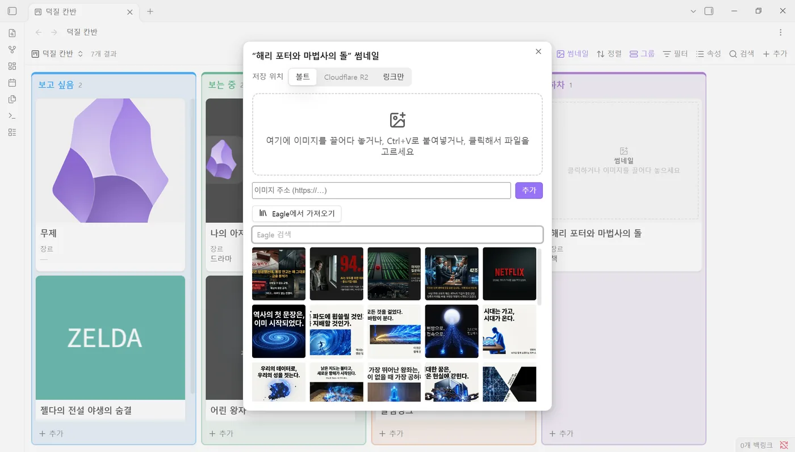 |  |

| YouTube link | New kanban | Rename a group |
|---|---|---|
| 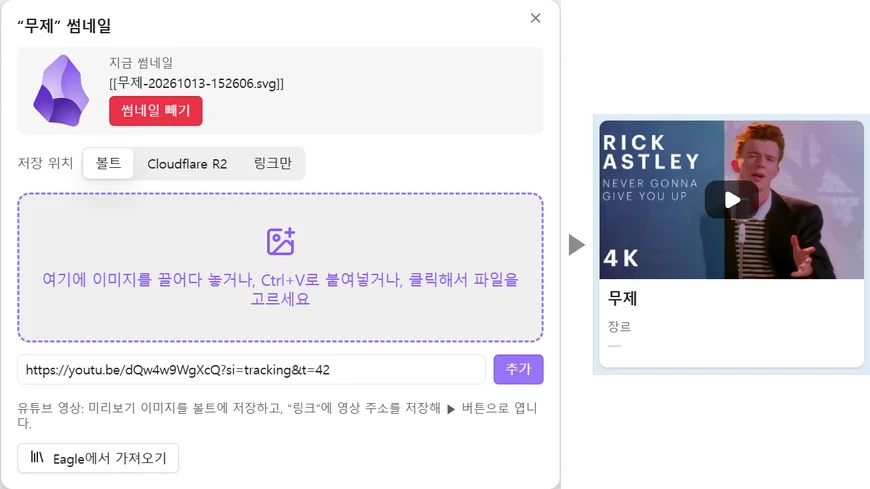 | 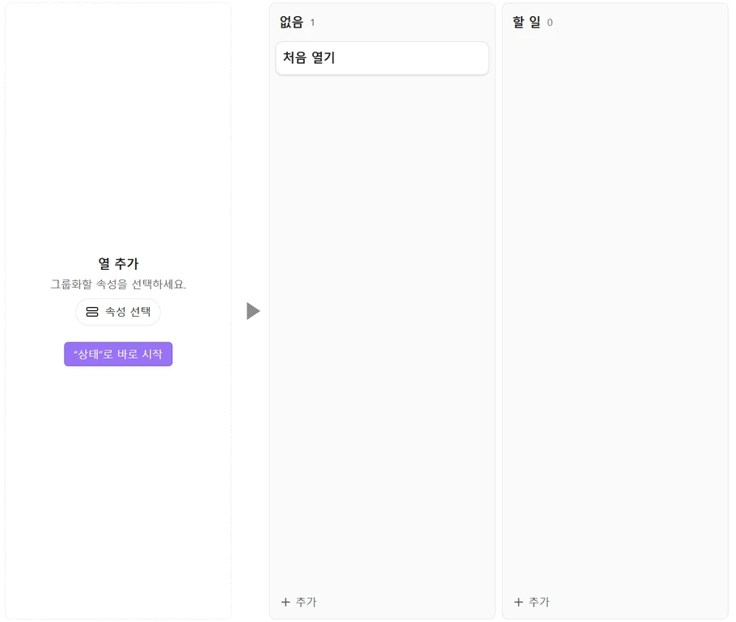 | 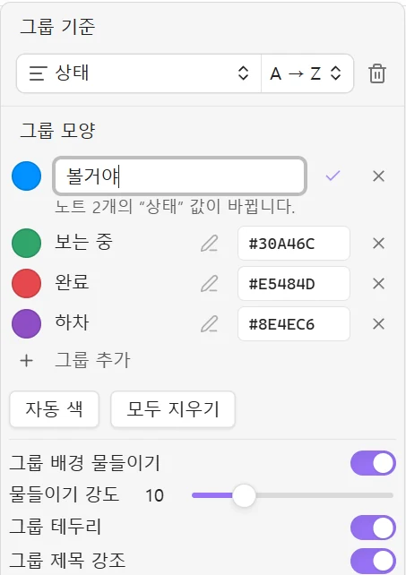 |

| Table | List | Cards |
|---|---|---|
| 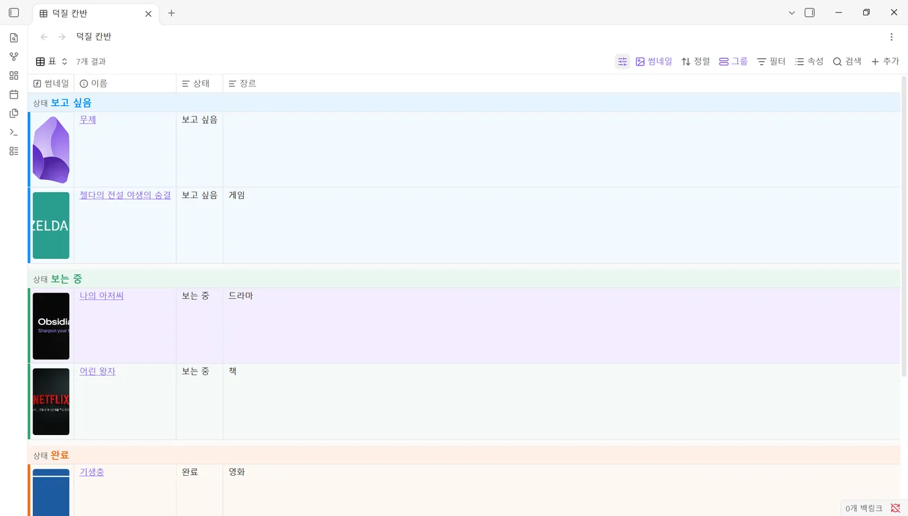 | 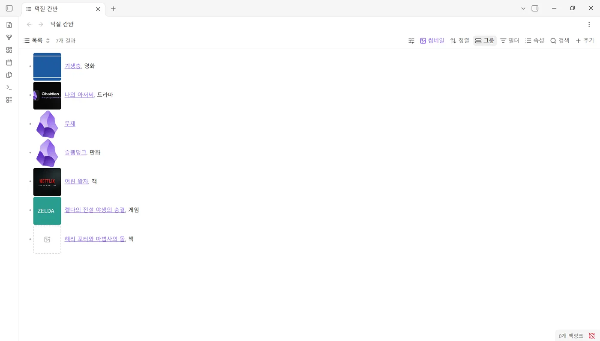 | 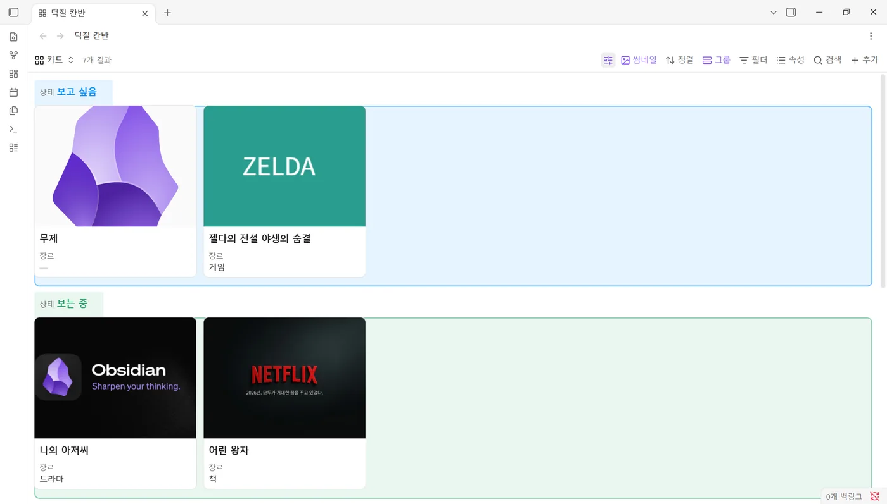 |

## How to use

1. Open a `.base` file. Two buttons appear before **Sort** in the toolbar: a sliders button and **Thumbnails**.
2. Click **Thumbnails** to turn thumbnails on in the view you are looking at. Click again to turn them off.
3. Click a dashed frame (or drop an image on it) to add a thumbnail to that note.
4. Use the sliders button for this view's look, this base's settings and group colors, or open **Group** and use **Group look**.
5. In a table, right-click a header or a cell → **Format cells…**, or double-click the line between two headers (or under a row) to fit it. The same works in a table embedded in a note.

You can also right-click a note → **Add or change thumbnail**, or use the command palette (**Open the look panel of this base**, **Show or hide thumbnails in every view**, and the three table commands, for the active Bases tab or the embedded table you used last).

## Your setup stays yours

- The plugin reads first: a base's own image property is found and used as it is.
- It writes only when you click, and only fills what is empty. Settings for one base are stored in that base and nowhere else.
- Look settings are stored per view, inside that view in the base file; base settings at the top of the base file. The plugin settings only hold connections.
- Table formats are set by hand, cell by cell or column by column, and stored in that view only. Opening a base never writes anything, and a table nobody formats stays exactly as it was. While a base is open, the plugin changes what Obsidian holds, unsaved edits included, and lets Obsidian save it, so a change you just made is never lost.
- The same goes for embedded bases: opening a note that embeds a base writes nothing, and a change made in the embedded table is handed to Obsidian, which saves it in the base file or in the note's code block, as it saves your own changes there.

## If you remove the plugin

Thumbnails are ordinary note properties (`"[[image.png]]"` or a web address), and the base files only use standard Bases settings (`image`, the `image()` formula). After removing the plugin, core Bases keeps showing every thumbnail; images stay in your vault. Only the extras go: dashed frames, ▶ buttons, group colors, table cell colors and the tidy table and list look. Fitted column widths and row heights stay, because they are Obsidian's own settings. The `achmageLook:` entries left in base files are ignored by Obsidian, and kept when it saves; install the plugin again and the formats come back.

## What it writes

- **Notes:** the base's thumbnail property (`thumbnail` by default, `썸네일` in Korean), set to `"[[image.png]]"` for vault images or to a web address. Nothing is written to notes that have no thumbnail. A YouTube thumbnail also saves the video address in the link property, unless that property already holds another address. Renaming a group changes the grouping property in the notes of that group, only when you confirm it.
- **Images:** saved in the base's image folder (`Thumbnails` by default), named after the note.
- **Base files:** turning thumbnails on fills standard Bases settings where a view has none (`image`, `imageAspectRatio`, `rowHeight`, column width, and an `image()` formula column for tables and lists). Plugin data is stored under `achmageLook:` keys in the same file: the base's own settings and group colors at the top, and each view's look inside that view. Adding a group writes the view's `groupOrder`, the setting Obsidian uses for groups in manual order. Table formats go to that view's `achmageLook.format` (`header`, `columns`, `rows` and `cells`, with `light` and `dark` colors); fitting writes Obsidian's own `columnSize` and `rowHeight`. Renaming or moving a formatted note updates its path in the bases that format it.
- **Code blocks:** a base written in a ```` ```base ```` code block keeps the same keys inside the code block, saved there by Obsidian. Its row and cell formats do not follow renamed notes.

## Cloudflare R2

Set up exactly like the CMDS Eagle plugin: **Worker URL**, **API Key** (the password you saved in the worker as `UPLOAD_API_KEY`) and **Public URL**. The image is sent to `Worker URL/upload`, and the note gets `Public URL/key`. If CMDS Eagle is installed in the vault, **Import from CMDS Eagle** in the settings copies its R2 settings. The API key is kept in Obsidian's secret storage, not in the plugin's settings file.

## Disclosures

- **Network use:** only when you ask for it: downloading an image from an address you entered or dropped (YouTube previews come from `i.ytimg.com`), uploading to your own Cloudflare worker, and talking to the Eagle app on `localhost`. No telemetry.
- **Files outside the vault:** when you pick an image from Eagle, or paste the path of an image file on your computer, the plugin reads that one file (desktop only) and copies it into the vault.
- **Bases interface:** Bases has no public API for decorating its built-in views. The toolbar buttons, dashed frames, group colors, the Group menu section, table cell formats and the double-click on column and row lines are added to Obsidian's own Bases interface; the format items join Obsidian's menus through its public menu API. Embedded bases are found through the objects Obsidian keeps for the notes, previews and canvases that show them, and their changes go through Obsidian's own view settings. If a future Obsidian version changes that interface, these parts switch off quietly, while the commands, the thumbnail window and the base settings keep working.

## Compatibility

Obsidian 1.13 or newer (cards, table, list). Kanban needs Obsidian 1.14. Table formatting was tested on Obsidian 1.15.1, 1.15.0 and 1.14.5 (Windows); embedded bases (notes, code blocks, hover previews, canvas cards) on 1.15.1. In embedded bases only table formats and the table tools are added.

## License

MIT © Achmage

---

## 한국어

순정 Obsidian **Bases**(카드·칸반·표·목록)에 **썸네일**, **그룹 색**, 엑셀 같은 **표 서식**을 더하는 애드온입니다. 별도 화면을 띄우지 않고, Bases는 그대로 쓰면서 이미지 넣기와 보기 좋게 정리하기만 쉽게 만듭니다.

**1.4.0 새 기능: 노트에 넣은 베이스에도 표 서식**
- **서식이 그대로 보입니다.** 노트에 넣은 베이스(`![[베이스.base#뷰]]`), ```` ```base ```` 코드 블록, 링크 미리보기, 캔버스의 베이스 카드에서도 베이스에서 정한 표 서식이 칠해집니다. 읽기 모드와 라이브 프리뷰 모두, 테마별 색도 그대로입니다.
- **그 자리에서 고칩니다.** 노트 속 표의 머리글·칸·선택 범위를 우클릭하면 **셀 서식…**과 맞춤·지우기가 베이스 탭과 똑같이 뜹니다. 경계 더블클릭, 행 높이 끌기, 표 명령 3개(마지막으로 누른 표 기준)도 됩니다.
- **저장은 Obsidian이.** 파일로 넣은 베이스는 그 `.base` 파일에, 코드 블록은 노트 속 그 코드 블록에 Obsidian이 저장합니다. 베이스 탭과 노트 속 표가 서로 따라 바뀝니다. 코드 블록은 Obsidian이 저장할 때 자기 방식으로 다시 씁니다(열 너비를 바꿀 때와 같음).
- **글자 위 우클릭.** 칸의 글자 위를 눌러도 표 메뉴가 뜨고, 우클릭만으로 칸이 편집 상태가 되지 않습니다. 편집 중인 칸과 링크는 원래 메뉴를 씁니다.
- **열 맞춤 바로잡기.** 글자 칸을 글자 폭으로 재서, 넓은 열을 줄이는 맞춤도 됩니다.
- 썸네일·그룹 색·조절 패널은 지금처럼 베이스 탭에서만 꾸밉니다. ([1.4.0 릴리즈 노트](release-notes/1.4.0.md))

**1.3.0: 표를 엑셀처럼**
- **우클릭으로 서식.** 머리글·칸·드래그로 고른 여러 칸을 우클릭하면 Obsidian 메뉴에 **셀 서식…**이 붙습니다. 머리글·열·행·칸·선택한 칸마다 글자색·배경색(팔레트 9색과 직접 고르기)·굵게·기울임·정렬을 정합니다.
- **라이트·다크 따로.** 글자색·배경색은 테마마다 따로 저장되고 그 테마에서만 보입니다. 서식 창의 ☀·☾ 탭으로 테마를 바꾸지 않고 다른 테마의 색도 정합니다.
- **경계 더블클릭으로 맞춤.** 머리글 사이 경계를 더블클릭하면 열 너비가 내용에 맞춰지고, 한 번 더 하면 Obsidian 자동 너비로 돌아갑니다. 행 아래 경계를 더블클릭하면 행 높이가 Obsidian의 네 단계 중 내용이 다 보이는 가장 낮은 단계로 맞춰집니다(Bases는 한 뷰의 모든 행이 같은 높이라 뷰 단위로 맞춥니다).
- **그 뷰에만 저장.** 서식은 그 뷰의 `achmageLook.format`에, 열 너비·행 높이는 Obsidian 순정 `columnSize`·`rowHeight`에 저장됩니다. 열어 보기만 해서는 아무것도 쓰지 않고, 노트 이름이나 위치를 바꾸면 행·칸 서식이 따라갑니다. ([1.3.0 릴리즈 노트](release-notes/1.3.0.md))

**1.2.0: 뷰마다 자기 모양**
- **뷰마다 따로 설정.** 카드 크기·열 너비·줄 높이·목록 썸네일 크기·썸네일 모양과 맞춤·빈 칸 표시·정돈·호버·그룹 모양을 뷰마다 정합니다. 카드 뷰를 바꿔도 같은 베이스의 칸반·목록·표 뷰는 그대로입니다.
- **썸네일 버튼은 지금 보는 뷰에만.** 모든 뷰를 한 번에 켜고 끄는 것은 **이 베이스**의 버튼으로 따로 합니다.
- **설정은 전부 베이스 파일 안에.** 플러그인 설정에는 연결(Cloudflare R2, Eagle)만 남았습니다. 썸네일 속성·이미지 폴더·저장 위치·새 칸반은 베이스마다, 모양은 뷰마다 정합니다.
- 업데이트해도 아무 파일도 다시 쓰지 않습니다. 예전 버전에서 정한 값은 그 뷰에서 바꿀 때까지 그대로 적용됩니다. ([1.2.0 릴리즈 노트](release-notes/1.2.0.md))

**1.1.0: 베이스마다 자기 설정 그대로**
- **이미 해 둔 설정은 건드리지 않습니다.** 자기 속성(`cover`, `banner` 등)으로 이미지를 보여 주던 베이스는 그 속성을 그대로 씁니다. 썸네일을 켜도 이미지가 없는 뷰만 채우고, 기존 이미지 설정·비율·맞춤·크기·열 너비는 바꾸지 않습니다.
- **베이스마다 따로 설정.** 조절 버튼 → **이 베이스**에서 그 베이스만의 썸네일 속성·링크 속성·이미지 폴더를 정합니다. 입력하면 그 베이스 노트들이 쓰는 속성을 검색하고, 각 속성에 노트 몇 개·이미지 몇 개가 있는지 보여 줍니다.
- **열기만 해서는 아무것도 바뀌지 않습니다.** 새 칸반 자동 묶기는 새로 만든 베이스나 방금 칸반으로 바꾼 뷰에만 적용합니다.
- 표·목록 이미지 정돈은 이 플러그인이 설정한 베이스에만 적용합니다. ([1.1.0 릴리즈 노트](release-notes/1.1.0.md))

- **썸네일 켜기 한 번**: 도구 막대의 **썸네일** 버튼으로 지금 보는 뷰에 썸네일을 켭니다. 이미지가 없는 카드에는 점선 칸이 뜨고, 클릭하거나 이미지를 끌어다 놓으면 끝입니다.
- **넣는 방법 네 가지**: 파일 끌어다 놓기·붙여넣기(Ctrl+V), 이미지 주소, **Cloudflare R2** 업로드, **Eagle** 앱에서 고르기. 썸네일 창에 어느 속성·폴더로 저장되는지 표시됩니다.
- **주소 칸에 무엇이든**: 웹 주소, 마크다운·HTML 이미지, `[[볼트 이미지]]`·볼트 경로, `obsidian://` 링크, 내 컴퓨터 파일 경로, `data:` 이미지까지 알아서 알아봅니다.
- **유튜브 링크**: 영상 미리보기 이미지가 썸네일이 되고, 썸네일의 ▶ 버튼으로 영상을 엽니다.
- **새 칸반 바로 쓰기**: "속성 선택" 빈 화면 대신 상태 속성으로 묶어 카드가 바로 보입니다.
- **조절 패널 하나로 전부**: **이 뷰**(레이아웃·크기·모양·맞춤·빈 칸·호버), **이 베이스**(썸네일 속성·링크 속성·이미지 폴더·저장 위치·새 칸반·모든 뷰 켜기/끄기), **그룹**(베이스 공통 색, 이 뷰의 그룹 모양)으로 나뉩니다.
- **그룹 색·이름 바꾸기·그룹 추가**: 그룹마다 색을 정하고, 연필 버튼으로 그룹 노트 전부의 값을 한 번에 바꾸고, 빈 그룹(새 칸반 열)을 추가합니다.
- **호버 디테일**: 카드는 살짝 떠오르고, 표·목록은 줄에 옅은 강조색이 깔립니다.

**플러그인을 지워도**: 썸네일은 보통 노트 속성(`"[[이미지.png]]"` 또는 웹 주소)이고, 베이스 파일은 순정 Bases 설정(`image`, `image()` 수식)만 씁니다. 그래서 플러그인을 지워도 순정 Bases가 썸네일을 그대로 보여 주고, 이미지는 볼트에 남습니다. 사라지는 것은 점선 칸·▶ 버튼·그룹 색·표 칸 색·표·목록 정돈 같은 꾸미기뿐입니다. 맞춘 열 너비와 행 높이는 Obsidian 순정 설정이라 그대로 남습니다. 남은 `achmageLook:` 항목은 Obsidian이 무시하고 저장할 때도 지우지 않으므로, 다시 설치하면 서식이 돌아옵니다.

**노트에 쓰는 것**: 그 베이스의 썸네일 속성 하나(기본 `썸네일`). 썸네일이 없는 노트에는 아무것도 쓰지 않습니다. 베이스 설정과 그룹 색은 `.base` 파일 맨 위의 `achmageLook:`에, 뷰 모양과 표 서식은 그 뷰 안의 `achmageLook:`에 저장되어 베이스와 함께 다닙니다. 베이스가 열려 있으면 Obsidian이 아직 저장하지 않은 변경 위에 고치고 저장은 Obsidian이 해서, 방금 한 변경이 사라지지 않습니다. 노트 속 베이스도 같습니다. 열어 보기만 해서는 아무것도 쓰지 않고, 바꾼 것은 Obsidian이 베이스 파일이나 노트의 코드 블록에 저장합니다. 코드 블록 베이스의 행·칸 서식은 노트 이름을 바꿔도 따라가지 않습니다.

**Cloudflare R2**: CMDS Eagle과 똑같이 Worker URL / API Key / Public URL을 입력하고, 노트에는 `Public URL/키` 주소가 들어갑니다. API Key는 워커에 `UPLOAD_API_KEY`로 직접 정해 넣은 비밀번호이며, Obsidian 보안 저장소에 보관합니다.

**호환**: Obsidian 1.13 이상(칸반은 1.14 이상). 표 서식은 Obsidian 1.15.1·1.15.0·1.14.5(Windows)에서, 노트 속 베이스(노트·코드 블록·링크 미리보기·캔버스 카드)는 1.15.1에서 확인했습니다. 노트 속 베이스에는 표 서식과 표 도구만 더합니다.
