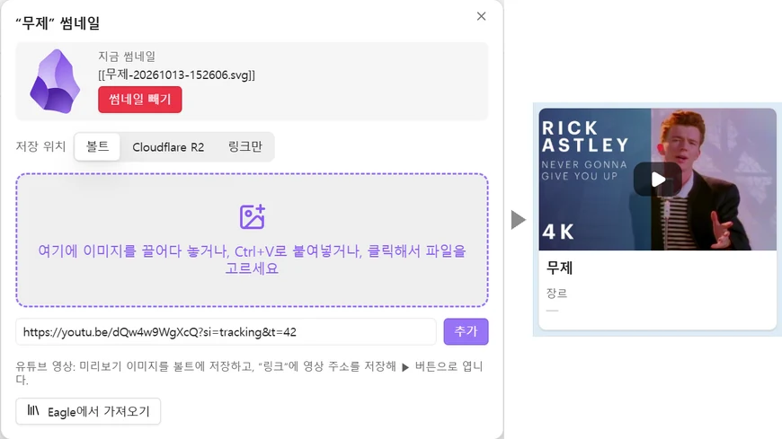
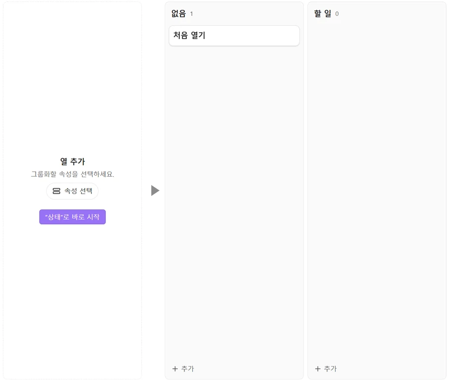
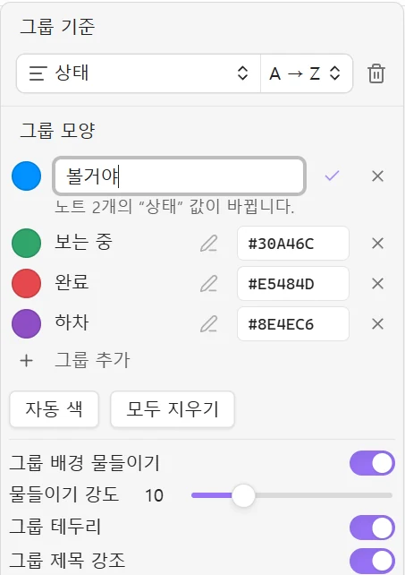
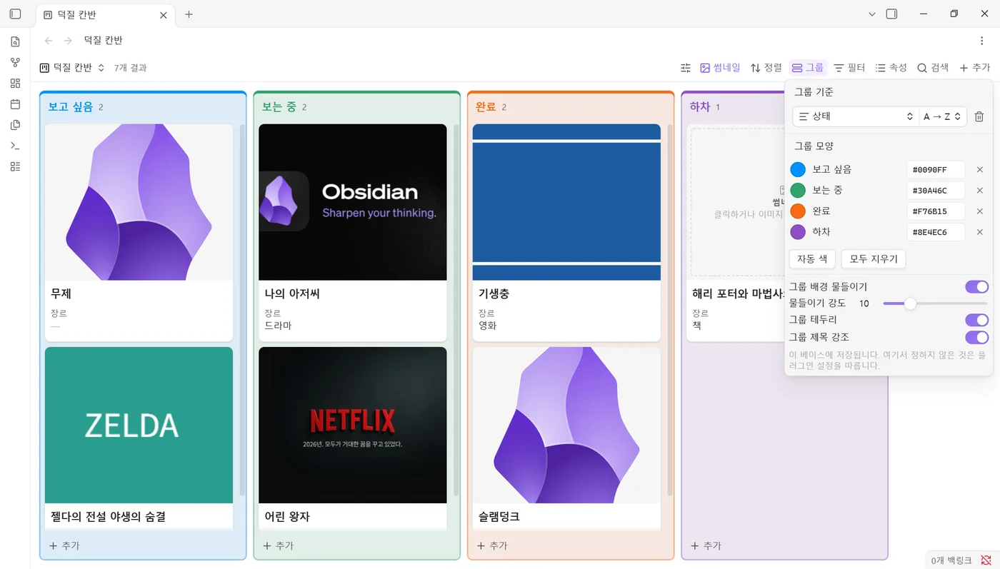
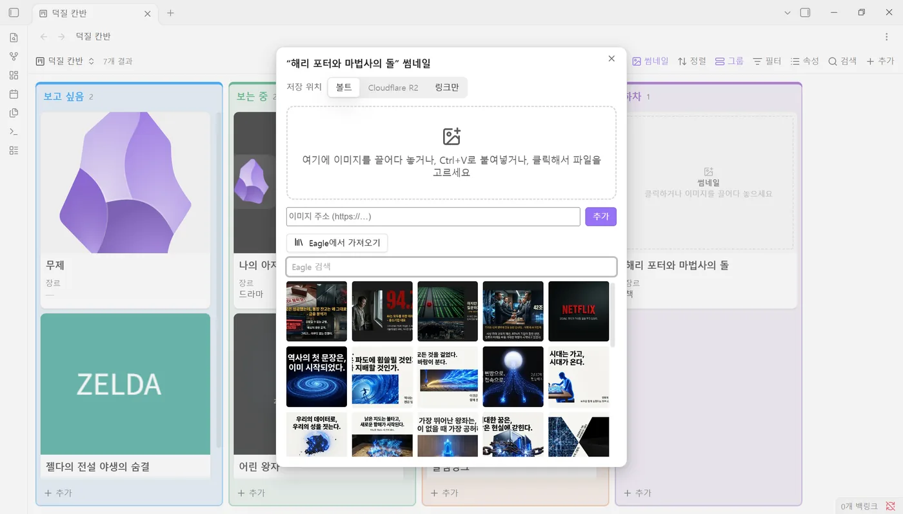
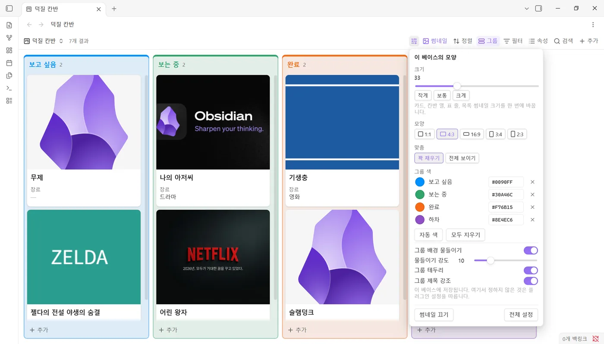
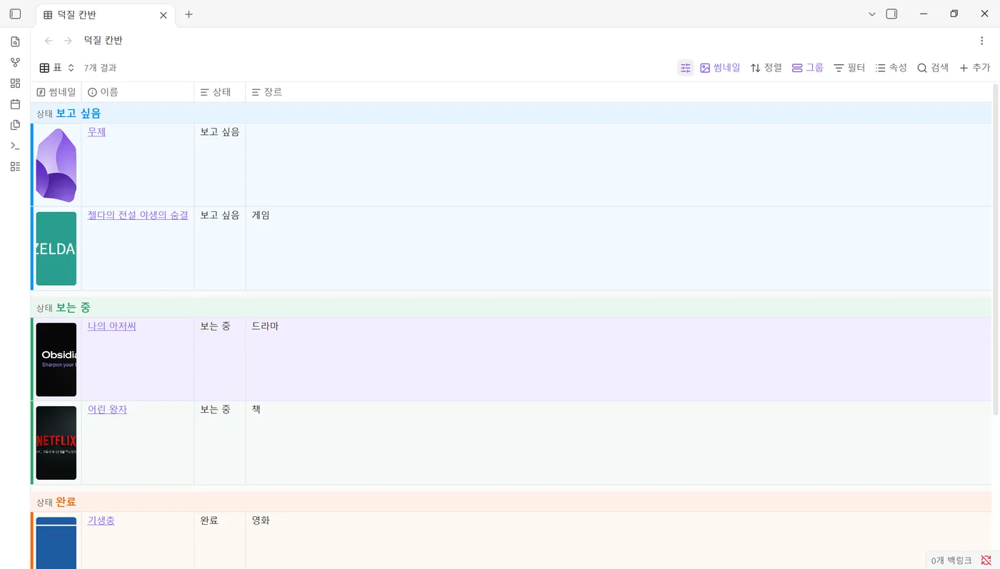
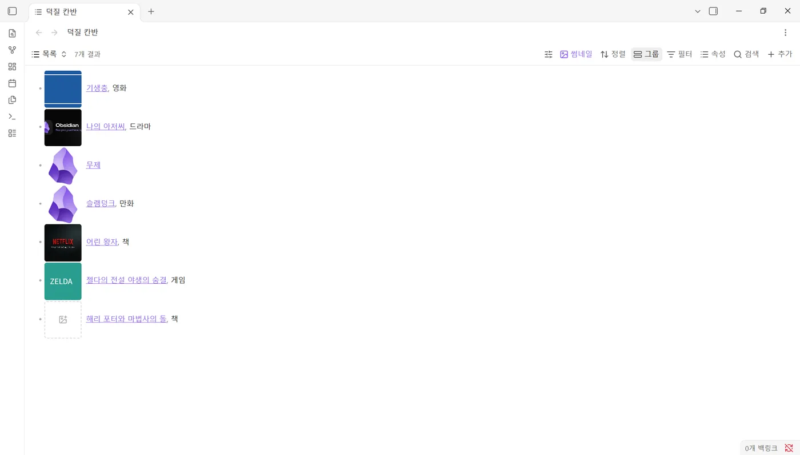
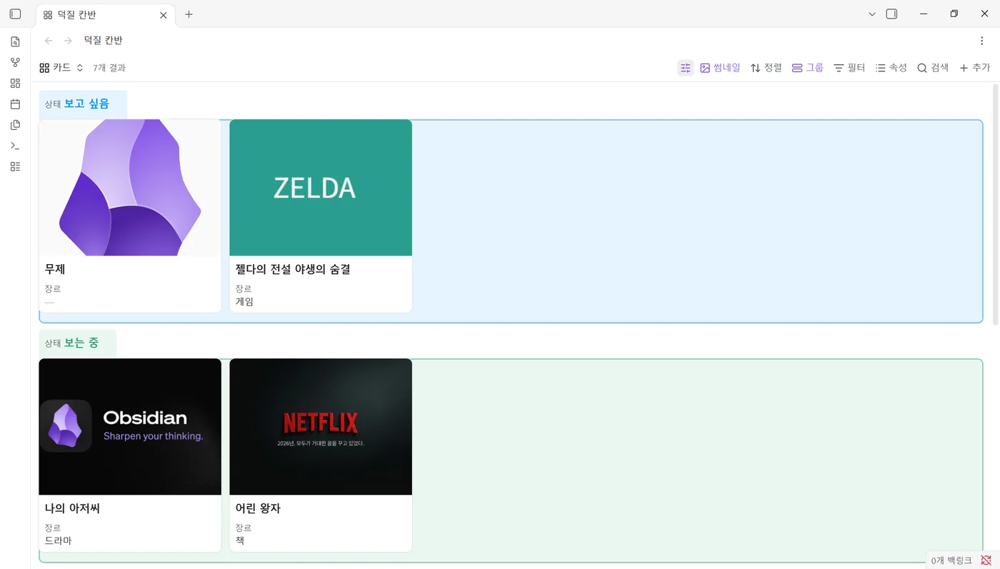

# Achmage Bases Look 1.0.4

Thumbnails and group colors for **core Obsidian Bases**: cards, kanban, table and list views.
No separate view or interface: your bases stay plain Bases, they just look and work better.

[한국어 설명은 아래에 있습니다.](#한국어) · [Changelog](CHANGELOG.md) · [Security](SECURITY.md) · [Contributing](CONTRIBUTING.md)

## New in 1.0.4

- **YouTube links become thumbnails.** Paste or drop a YouTube link (watch, youtu.be, shorts, embed, live) and the video's preview image becomes the thumbnail.
- **▶ opens the video.** The video address is saved in the note's link property (`link` by default). Thumbnails of notes with a link get a ▶ button that opens it in your browser; other web addresses get a small open button. An address already in the link property is never overwritten.

[1.0.4 release notes](release-notes/1.0.4.md)

## New in 1.0.3

- **New kanban views show their cards at once.** A kanban view without a group property is grouped automatically, by a status property the notes use or by the one from the settings, so every card first shows under **None**. Then **Add group** and drag cards into the new columns.
- A grouping you removed yourself stays removed; a **Start with …** button appears next to Obsidian's “Choose a property” instead. Turn the automatic part off in the settings.

[1.0.3 release notes](release-notes/1.0.3.md)

## New in 1.0.2

- **Rename a group in one go.** The pencil next to a group renames it in every note of that group. A line under the field says how many notes change.
- **Add an empty group**, such as a new kanban column, from the end of the group list.
- **Paste any image reference** into the address field: a web address, a Markdown or HTML image, a vault image, an `obsidian://` link, a file path or a `data:` image.
- **Fixed:** thumbnails now follow a view when its layout changes.

[1.0.2 release notes](release-notes/1.0.2.md)

 

## What it adds

- **Drop-in thumbnails.** Turn on thumbnails for a base with one click. Every card without an image shows a dashed frame: click it, or drop an image file or a web image on it.
- **One thumbnail window, four sources.** Drop or paste (Ctrl+V) an image, enter an image address, upload to **Cloudflare R2**, or pick from the **Eagle** app.
- **Paste anything as the address.** A web address on its own or inside a Markdown or HTML image, a wiki link or path to an image in the vault, an `obsidian://` link, a file path on your computer, or a `data:` image. A line under the field says what it found and what will happen. Vault images are linked without a copy; addresses already on Cloudflare R2 are not uploaded again.
- **Tidy everywhere.** Cards and kanban use Bases' own cover images. Table and list views get a thumbnail column through the built-in `image()` formula, shown as same-size squares.
- **One look panel.** The sliders button next to “Thumbnails” holds everything: this view’s layout, column width, card size, row height, image fit and ratio; size, shape (1:1, 4:3, 16:9, 3:4, 2:3) and fit for every view at once; and group colors. Sections fold, and the panel always fits in the window.
- **Group colors.** Give each group (kanban column, card group, table group) its own color. A light background, a colored border and a bold colored heading make each group read as one block. Set it right in the native **Group** menu, under “Group by”.
- **Rename and add groups.** The pencil next to a group renames it: every note in the group gets the new value at once, and the group keeps its color and place. **Add group** creates an empty group at the end, such as a new kanban column.
- **Hover details.** Cards lift slightly under the mouse; table and list rows get a light highlight in your accent color or a color you choose.

| Group menu | Thumbnail window | Look panel |
|---|---|---|
|  |  |  |

| Table | List | Cards |
|---|---|---|
|  |  |  |

## How to use

1. Open a `.base` file. Two buttons appear before **Sort** in the toolbar: a sliders button and **Thumbnails**.
2. Click **Thumbnails** to turn thumbnails on for the whole base. Click again to turn them off.
3. Click a dashed frame (or drop an image on it) to add a thumbnail to that note.
4. Use the sliders button for size, shape, fit and group colors, or open **Group** and use **Group look**.

You can also right-click a note → **Add or change thumbnail**, or use the command palette.

## What it writes

- **Notes:** one property, `thumbnail` by default (`썸네일` in Korean), set to `"[[image.png]]"` for vault images or to a web address. Nothing is written to notes that have no thumbnail. A YouTube thumbnail also saves the video address in the link property (`link`, `링크` in Korean), unless that property already holds another address. Renaming a group changes the grouping property (for example `status`) in the notes of that group, and only when you confirm it.
- **Images:** saved in the image folder from the settings (`Thumbnails` by default), named after the note.
- **Base files:** turning thumbnails on writes standard Bases settings (`image`, `imageAspectRatio`, `imageFit`, `cardSize`, `columnWidth`, `rowHeight`, and an `image()` formula column for tables and lists). Group colors and group look are stored under an `achmageLook:` key in the same file. Obsidian keeps this key when it saves the base. Adding a group writes the view’s `groupOrder`, the same setting Obsidian uses for groups in manual order: groups not in that list stay hidden until you show them in the Group menu.

## Cloudflare R2

Set up exactly like the CMDS Eagle plugin: **Worker URL**, **API Key** (the password you saved in the worker as `UPLOAD_API_KEY`) and **Public URL**. The image is sent to `Worker URL/upload`, and the note gets `Public URL/key`. If CMDS Eagle is installed in the vault, **Import from CMDS Eagle** in the settings copies its R2 settings. The API key is kept in Obsidian's secret storage, not in the plugin's settings file.

## Disclosures

- **Network use:** only when you ask for it: downloading an image from an address you entered or dropped, uploading to your own Cloudflare worker, and talking to the Eagle app on `localhost`. No telemetry.
- **Files outside the vault:** when you pick an image from Eagle, or paste the path of an image file on your computer, the plugin reads that one file (desktop only) and copies it into the vault.
- **Bases interface:** Bases has no public API for decorating its built-in views. The toolbar buttons, dashed frames, group colors and the Group menu section are added to Obsidian's own Bases interface. If a future Obsidian version changes that interface, these parts switch off quietly, while the commands, the thumbnail window and the base settings keep working.

## Compatibility

Obsidian 1.13 or newer (cards, table, list). Kanban needs Obsidian 1.14. Embedded bases inside notes are not decorated.

## License

MIT © Achmage

---

## 한국어

순정 Obsidian **Bases**(카드·칸반·표·목록)에 **썸네일**과 **그룹 색**을 더하는 애드온입니다. 별도 화면을 띄우지 않고, Bases는 그대로 쓰면서 이미지 넣기와 보기 좋게 정리하기만 쉽게 만듭니다.

**1.0.4 새 기능**: 유튜브 링크(watch·youtu.be·shorts·embed·live)를 붙여넣거나 끌어다 놓으면 영상 미리보기 이미지가 썸네일이 되고, 영상 주소는 노트의 `링크` 속성에 저장되어 썸네일의 **▶ 버튼**으로 브라우저에서 바로 열립니다. 유튜브가 아닌 웹 주소는 모서리 열기 버튼으로 열리고, `링크`에 이미 다른 주소가 있으면 덮어쓰지 않습니다. ([1.0.4 릴리즈 노트](release-notes/1.0.4.md))

**1.0.3 새 기능**: 그룹 기준이 없는 새 칸반은 "속성 선택" 빈 화면 대신 바로 카드가 보입니다. 상태 속성이 있으면 그 값별 열로, 없으면 기본 속성(`상태`)으로 묶어 **"없음" 열**에 먼저 모으니, **그룹 추가**로 열을 만들고 카드를 끌어다 놓으세요. 직접 지운 그룹 기준은 다시 묶지 않고 "'상태'로 바로 시작" 버튼을 보여 주며, 설정 **새 칸반 바로 쓰기**로 끌 수 있습니다. ([1.0.3 릴리즈 노트](release-notes/1.0.3.md))

**1.0.2 새 기능**: 그룹 옆 연필 버튼으로 그룹 이름을 바꾸면 그 그룹 노트 전부의 값이 한 번에 바뀌고, **그룹 추가**로 빈 그룹(새 칸반 열)을 만듭니다. 이미지 주소 칸은 어떤 형식으로 붙여넣어도 알아서 알아봅니다. 레이아웃을 바꾸면 썸네일이 사라지던 문제도 고쳤습니다. ([변경 내역](CHANGELOG.md) · [보안 안내](SECURITY.md))

- **썸네일 켜기 한 번**: 도구 막대의 **썸네일** 버튼을 누르면 베이스 전체에 썸네일이 켜집니다. 이미지가 없는 카드에는 점선 칸이 뜨고, 클릭하거나 이미지를 끌어다 놓으면 끝입니다.
- **넣는 방법 네 가지**: 파일 끌어다 놓기·붙여넣기(Ctrl+V), 웹 이미지 주소, **Cloudflare R2** 업로드, **Eagle** 앱에서 고르기.
- **주소 칸에 무엇이든**: 웹 주소, 마크다운·HTML 이미지, `[[볼트 이미지]]`·볼트 경로, `obsidian://` 링크, 내 컴퓨터 파일 경로, `data:` 이미지까지 알아서 알아보고, 무엇으로 알아봤는지 칸 아래에 보여 줍니다. 볼트 이미지는 복사 없이 연결하고, 이미 R2에 있는 주소는 다시 올리지 않습니다.
- **모든 뷰 정돈**: 카드·칸반은 Bases 기본 표지 이미지, 표·목록은 기본 `image()` 수식으로 같은 크기 정사각형 썸네일을 보여 줍니다.
- **조절 패널 하나로 전부**: 썸네일 버튼 앞의 조절 버튼에서 현재 뷰 설정(레이아웃, 열 너비·카드 크기·줄 높이, 이미지 맞춤·비율), 모든 뷰의 크기·모양·맞춤, 그룹 색까지 한곳에서 정합니다. 섹션은 접고 펼 수 있고 화면 안에 맞춰 스크롤됩니다.
- **그룹 색**: 그룹(칸반 열, 카드 그룹, 표 그룹)마다 색을 정하면 옅은 배경·테두리·굵은 색 제목으로 한 덩어리처럼 보입니다. 기본 **그룹** 메뉴의 “그룹 기준” 아래 **그룹 모양**에서 바로 정합니다.
- **그룹 이름 바꾸기·그룹 추가**: 그룹 옆 연필 버튼으로 이름을 바꾸면 그 그룹 노트 전부의 값이 한꺼번에 바뀌고(색·순서 유지), **그룹 추가**로 빈 그룹(예: 새 칸반 열)을 맨 끝에 만듭니다.
- **호버 디테일**: 카드는 마우스를 올리면 살짝 떠오르고, 표·목록은 줄에 옅은 강조색이 깔립니다(색 변경 가능).

**노트에 쓰는 것**: `썸네일` 속성 하나(볼트 이미지는 `"[[이미지.png]]"`, 웹 이미지는 주소). 썸네일이 없는 노트에는 아무것도 쓰지 않습니다. 그룹 색은 `.base` 파일 안의 `achmageLook:` 항목에 저장되어 베이스와 함께 다닙니다.

**Cloudflare R2**: CMDS Eagle과 똑같이 Worker URL / API Key / Public URL을 입력하고, 노트에는 `Public URL/키` 주소가 들어갑니다. API Key는 워커에 `UPLOAD_API_KEY`로 직접 정해 넣은 비밀번호이며, Obsidian 보안 저장소에 보관합니다. 설정의 **CMDS Eagle 설정 가져오기**로 한 번에 옮길 수 있습니다.

**호환**: Obsidian 1.13 이상(칸반은 1.14 이상). 노트 안에 넣은 베이스는 꾸미지 않습니다.
